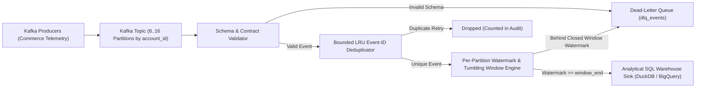

# Technical Architecture — Real-Time Data Platform

## 1. System Overview

`real-time-data-platform` ingests high-volume commerce telemetry events (`order_created`, `payment_authorized`, `shipment_updated`, `refund_issued`) from partitioned Kafka topics, enforces schema and idempotency contracts, aggregates watermarked event-time windows, routes malformed or excessively late records to a Dead-Letter Queue (DLQ), and commits auditable analytical tables to a local DuckDB warehouse and BigQuery-compatible partitioned/clustered schemas.

## 2. Core Design Guarantees

1. **Deterministic Partition Affinity**:
   - Events are routed to partition `SHA256(account_id)[:8] mod P`, guaranteeing that all events for a given `account_id` share a single partition clock and watermark without cross-partition shuffle during per-account window aggregation.
2. **Idempotent Deduplication Across At-Least-Once Retries**:
   - Kafka producers and consumers operate under at-least-once delivery. The processor maintains a bounded LRU set of seen `event_id` keys (`dedup_capacity = 200,000`) and drops duplicate retries before mutating window state, while the warehouse sink uses primary-key `INSERT OR REPLACE` (`UPSERT`) on `(window_start_ms, window_end_ms, account_id)` and `event_id`.
3. **Per-Partition Event-Time Watermarks**:
   - For partition $p$, $\text{watermark}_p = \max(0, \max_{e \in p}(\text{occurred\_at\_ms}) - \text{max\_out\_of\_orderness\_ms})$.
   - A tumbling window $[w_{\text{start}}, w_{\text{end}})$ closes and flushes to the warehouse once $\text{watermark}_p \ge w_{\text{end}}$. Any subsequent arrival with $\text{occurred\_at\_ms} < w_{\text{end}}$ is routed to `dlq_events` (`category = 'late_arrival'`) rather than silently corrupting a closed rollup.
4. **End-to-End Conservation Invariant**:
   - Every batch verifies:
     $$\text{total\_received} = \text{accepted\_unique} + \text{duplicates\_dropped} + \text{late\_events\_dlq} + \text{invalid\_events\_dlq}$$
   - And across all closed windows:
     $$\sum_{\text{raw}} \text{signed\_amount\_cents} = \sum_{\text{rollups}} (\text{gross\_volume\_cents} - \text{refund\_volume\_cents}) = \sum_{\text{rollups}} \text{net\_volume\_cents}$$
